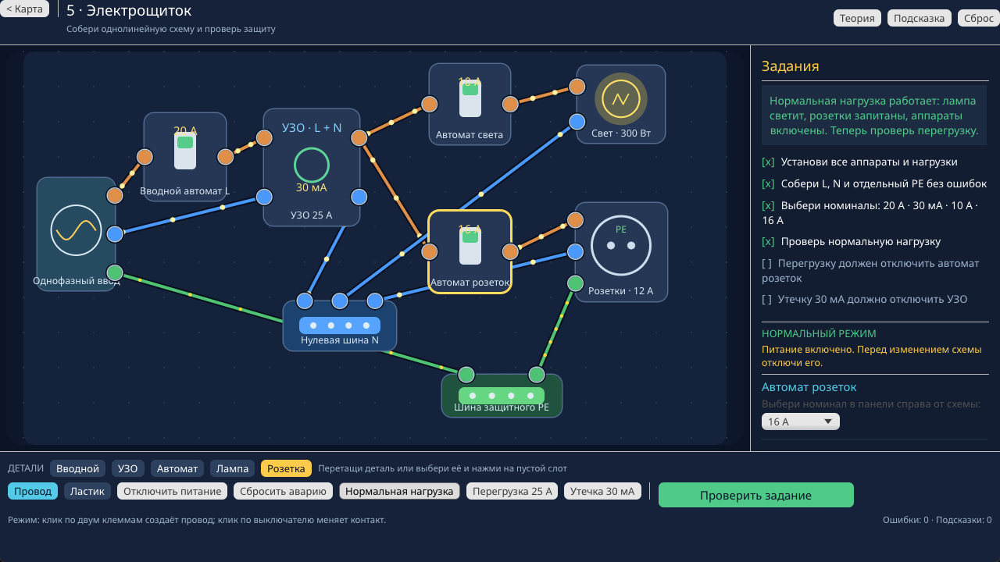

# ЭлектроКвест

Красочная десктопная игра на Rust для знакомства учащихся 7–9 классов с основами электротехники. Игрок собирает учебные схемы на интерактивном монтажном столе, измеряет параметры виртуальными приборами, находит неисправности и проверяет работу защиты в электрощитке.

Проект использует [eframe/egui](https://github.com/emilk/egui), работает локально и не требует сервера или регистрации.



## Что уже реализовано

- пять последовательно открывающихся уровней;
- установка деталей перетаскиванием или кликами;
- соединение клемм проводами, ластик и сброс схемы;
- анимация тока, свечение ламп и цветовое обозначение L/N/PE;
- закон Ома, последовательное и параллельное соединение;
- виртуальные амперметр, вольтметр и проверка сопротивления;
- диагностика обрыва предохранителя и короткого замыкания лампы;
- испытания нормальной нагрузки, перегрузки и утечки в щитке;
- краткая теория, цели, подсказки и объяснение ошибок;
- награда от одной до трёх звёзд и локальное сохранение прогресса;
- русский интерфейс и встроенный шрифт с кириллицей.

## Уровни

| № | Название | Задание |
|---|---|---|
| 1 | Первый свет | Установить выключатель и лампу, собрать замкнутую цепь и зажечь свет. |
| 2 | Подбери сопротивление | Рассчитать по закону Ома резистор для безопасного тока светодиода. |
| 3 | Две лампы | Сравнить последовательную и параллельную схемы, снять показания приборами. |
| 4 | Найди неисправность | Проверить источник, найти обрыв и замыкание, устранить причину до замены предохранителя. |
| 5 | Электрощиток | Собрать упрощённую однолинейную схему, выбрать номиналы и проверить автомат и УЗО. |

## Запуск на Windows

Требования:

- Windows 10/11 x86_64;
- Rust **1.95 или новее**, установленный через [rustup](https://rustup.rs/);
- драйвер с поддержкой OpenGL.

```bash
git clone https://github.com/Mdyuzhev/electro-quest.git
cd electro-quest
cargo run --release
```

После отдельной сборки:

```bash
cargo build --release
```

Исполняемый файл появится в `target/release/electro-quest.exe`. Его можно запустить двойным щелчком. Установщик на этапе прототипа не требуется.

## Управление

- **Установить деталь:** перетащить её из нижней панели в пустую рамку либо выбрать кликом и нажать на рамку.
- **Создать провод:** в режиме «Провод» последовательно нажать две клеммы.
- **Удалить провод:** выбрать «Ластик» и нажать на провод либо использовать список проводов справа.
- **Снять деталь:** правый клик по ней; закреплённые элементы стенда снять нельзя.
- **Включить/выключить:** обычный клик по выключателю.
- **Измерить:** выбрать прибор на нижней панели и нажать на элемент схемы.
- **Проверить задание:** зелёная кнопка под монтажным столом.

Три звезды выдаются без ошибок и подсказок, две — не более чем с одной подсказкой и тремя ошибками, в остальных случаях — одна. Подсказки не блокируют прохождение. Прогресс автоматически сохраняется в системном каталоге данных приложения; на главном экране есть полный сброс результатов.

## Структура проекта

| Путь | Назначение |
|---|---|
| `src/main.rs` | Запуск нативного окна. |
| `src/app.rs` | Экраны, панели, цели и сохраняемый прогресс. |
| `src/board.rs` | Монтажный стол, детали, клеммы, провода и анимации. |
| `src/gameplay.rs` | Действия игрока, диагностика, испытания и завершение уровней. |
| `src/model.rs` | Граф клемм, компоненты, соединения и состояние уровня. |
| `src/levels.rs` | Содержание и схемы пяти уровней. |
| `src/simulation.rs` | Учебные расчёты и сообщения о состоянии цепи. |
| `assets/fonts/` | Встроенный Noto Sans и его лицензия. |

Это прототип, а не универсальный редактор произвольных схем. Новый уровень можно добавить через определение компонентов, ожидаемых соединений, целей и правил проверки.

## Проверка проекта

```bash
cargo fmt --check
cargo clippy --all-targets -- -D warnings
cargo test
cargo build --release
```

Те же команды выполняются в GitHub Actions на `windows-latest`. Release-файл прикладывается к успешному запуску CI как временный артефакт.

## Границы модели и безопасность

**Игра предназначена только для обучения на виртуальных схемах. Это не руководство по самостоятельному монтажу, диагностике или ремонту электропроводки. Работы с реальной сетью 230 В и электрощитом должен выполнять квалифицированный специалист.**

В прототипе используются упрощённые школьные модели:

- цепи постоянного тока рассчитываются по заранее заданным сопротивлениям и `I = U / R`;
- переходные процессы, температура, время-токовые характеристики и несинусоидальные сигналы не моделируются;
- измерительные приборы подключаются к выбранному элементу автоматически;
- финальный щиток — сценарная однолинейная модель, а не монтажная схема;
- срабатывание автомата при перегрузке и УЗО при утечке показывает принцип защиты, но не заменяет инженерный расчёт.

## Лицензии

- Исходный код распространяется по [MIT](LICENSE).
- Шрифт Noto Sans принадлежит The Noto Project Authors и распространяется по [SIL Open Font License 1.1](assets/fonts/OFL.txt).
- Игровая графика рисуется программно и не использует сторонние изображения.

## Возможное развитие

- редактор дополнительных уровней и экспорт заданий для учителя;
- режим классной работы и локальные профили учеников;
- новые темы: мощность, работа тока, трансформатор и трёхфазные цепи;
- звук, озвучка и дополнительные параметры доступности;
- установщик Windows и подписанные релизы.
